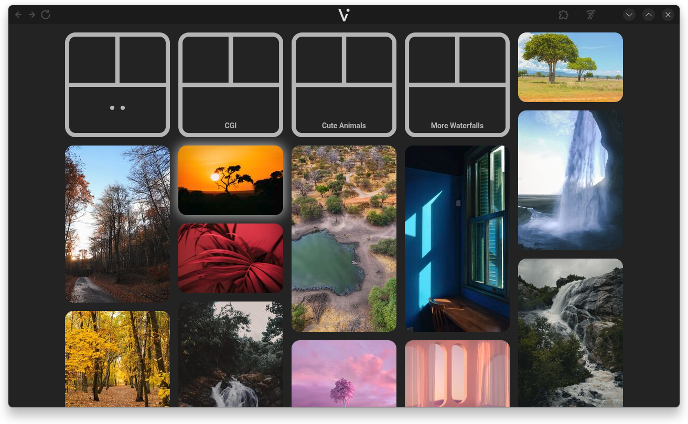

  

# Vistava Documentation

Welcome to the documentation of Vistava, the free open-source multimedia viewer!

  

Vistava is a chill, minimalist viewer for images and videos. It makes browsing your media simple - on any device.

- Browse your image and video library in peace
- Navigate via mouse, keyboard, touch screen, or gamepad
- Share your media to a TV, smartphone, or VR headset within your network
- View content from third-party sources with optional extensions

## About Vistava

The name "Vistava" comes from the Czech word "výstava" (pronounced ˈviːstava), meaning "exhibition" or "gallery" - which should both hint at the calm, distraction-free gallery aspect as well as the network sharing capabilities of the application. Pretty smart, isn't it?

### Project history

Vistava began as a university project in 2020. After graduating, I rewrote it a few times and kept tinkering with it every now and then to keep the brainrot at bay - which somewhat worked, and I even ended up with a cool application in the process!

### Usage of AI

Vistava itself was done entirely without the use of AI - meaning the code, design, icons and logo were completely human-made, without any LLM assistance (hence the "developed by a human" badge). 
GitHub Copilot (free tier) was used for proofreading the (human-written) texts of this documentation and the website, as well as for creating the initial design of the latter.

### Privacy

Vistava has no ads, analytics or user tracking, requires no subscriptions, does not depend on any cloud services or CDNs and can be used offline without internet access (until you decide to install extensions that pull media from the internet, of course). Vistava does not expose your data to the internet - even when the "local network sharing" feature is enabled (but please read the [related documentation](/3-usage?id=local-network-sharing) for information on how to use this feature safely!)

## License

Copyright (C) 2020-2026 Maximilian Bauer

This program is free software: you can redistribute it and/or modify
it under the terms of the GNU General Public License as published by
the Free Software Foundation, either version 3 of the License, or
(at your option) any later version.

This program is distributed in the hope that it will be useful,
but WITHOUT ANY WARRANTY; without even the implied warranty of
MERCHANTABILITY or FITNESS FOR A PARTICULAR PURPOSE.  See the
GNU General Public License for more details.

You should have received a copy of the GNU General Public License
along with this program.  If not, see <https://www.gnu.org/licenses/>.

### Third-party dependencies

Vistava uses the following third-party libraries or technologies:
- [.NET](https://dotnet.microsoft.com) (under the [MIT license](https://en.wikipedia.org/wiki/MIT_License))
- [ffmpeg](https://ffmpeg.org/) (under the [GNU General Public License (GPL) version 2](http://www.gnu.org/licenses/old-licenses/gpl-2.0.html))
- [FFMpegCore](https://github.com/rosenbjerg/FFMpegCore) (under the [MIT license](https://en.wikipedia.org/wiki/MIT_License))
- [LiteDB](https://www.litedb.org/) (under the [MIT license](https://en.wikipedia.org/wiki/MIT_License))
- [Magick.NET](https://github.com/dlemstra/Magick.NET) (under the [Apache License 2.0](https://www.apache.org/licenses/LICENSE-2.0))
- [qr-creator](https://github.com/nimiq/qr-creator) (under the [MIT license](https://en.wikipedia.org/wiki/MIT_License))
- [electron](https://www.electronjs.org/) (under the [MIT license](https://en.wikipedia.org/wiki/MIT_License))
- [electron-builder](https://www.electron.build/) (under the [MIT license](https://en.wikipedia.org/wiki/MIT_License))
- [7zip-min](https://www.npmjs.com/package/7zip-min) (under the [MIT license](https://en.wikipedia.org/wiki/MIT_License))